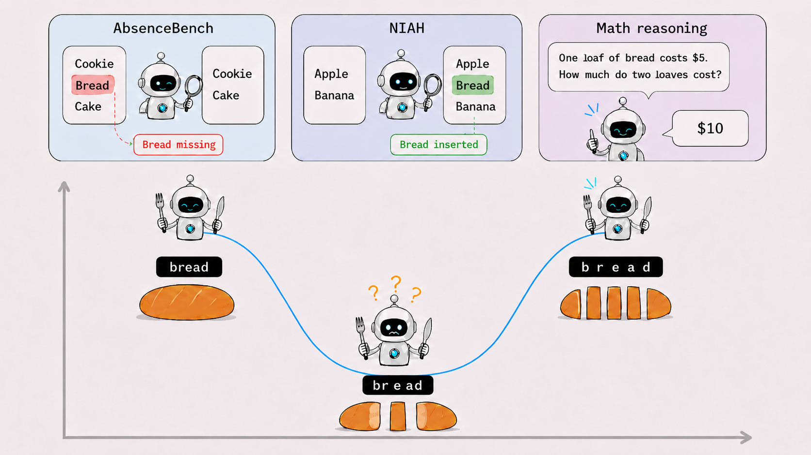

# The Text Uncanny Valley: Non-Monotonic Performance Degradation in LLM Information Retrieval

Official code repository for **The Text Uncanny Valley: Non-Monotonic Performance Degradation in LLM Information Retrieval** (**NeurIPS 2026, Evaluations & Datasets Track, Poster**).

The repository includes implementations and evaluation scripts for the experiments reported in the main paper and appendices. It is derived from **AbsenceBench**.

<p align="center">
  
</p>

<p align="center"><em>Figure 1. Bread slicing as an analogy for our text fragmentation method and the resulting Text Uncanny Valley phenomenon. We evaluate three tasks: AbsenceBench, NIAH-style task, and math reasoning. Image generated by ChatGPT.</em></p>

## Quick Start

### 1) Environment

```bash
python -m venv .venv
source .venv/bin/activate
pip install -r requirements.txt
```

Set API keys for the providers you evaluate:

```bash
export OPENAI_API_KEY=...
export ANTHROPIC_API_KEY=...
export GOOGLE_API_KEY=...
export TOGETHER_API_KEY=...
```

### 2) Input Data Format

Input should be JSONL where each row is one document:

```json
{"id": "doc-1", "lines": ["line A", "line B", "line C"], "metadata": {"source": "demo"}}
```

Required field: `lines` (list of strings). Optional: `id`, `metadata`.

> [!IMPORTANT]
> The public repository does not include benchmark documents, needle pools, or ICL examples. Prepare these files locally under `data/` before running the commands below. Dataset sources, licenses, and construction notes are provided in [`DATA.md`](DATA.md).

The commands expect the following local paths:

| File | Domain |
|------|--------|
| `data/legal_docs.jsonl` | Legal documents |
| `data/github_prs_extracted.jsonl` | GitHub PR diffs |
| `data/gsm8k_n80.jsonl` | GSM8K long-document construct |
| `data/examples.txt` | Optional few-shot ICL prefix passed via `--icl_file` |
| `data/needle/` | Optional NIAH needle pools (extra lines injected into modified context) |

If you run the ICL experiment, keep the prompt prefix in `data/examples.txt` and pass:

```bash
python run_benchmark.py ... --icl_file data/examples.txt
```

If you run the NIAH control, pass `--use_needle` and a `--needles_file` under `data/needle/`.
Example:

```bash
python run_benchmark.py \
  --input_file data/legal_docs.jsonl \
  --document_type legal_documents \
  --use_needle \
  --needles_file data/needle/ld/legal_needles.txt \
  --prob 0.1 \
  --sample_size 100 \
  --provider_models google:gemini-3.0-flash \
  --output_dir legal_docs_niah/ori
```

`data/needle/` naming convention in this repo:

- `*_needles.txt`: base needle sentences for a domain.
- `*_wa1.txt ... *_wa10.txt`: needle text already fragmented at increasing whitespace anomaly levels, typically aligned with WFR sweep steps.

### 3) Prepare a Word-Fragmentation Condition

Word fragmentation and omission are separate stages:

- `transformations/spacing_transform.py --intensity` sets the target probability of inserting a space at each eligible intra-word character gap. This is the parameter used to construct the nominal WFR sweep.
- `run_benchmark.py --prob` sets the probability that an input line is omitted in AbsenceBench, or triggers a needle insertion in NIAH. It does **not** control WFR.
- The transformation script records the realized per-document `word_fragmentation_rate` in JSONL metadata. Because insertion is stochastic, the realized rate can differ slightly from the target `--intensity`.

For example, prepare the target WFR = 0.3 condition with fragmentation seed 42:

```bash
python transformations/spacing_transform.py \
  --input data/legal_docs.jsonl \
  --mode intra_word \
  --intensity 0.3 \
  --seed 42 \
  --suffix _wfr_0_3 \
  --output_dir data/transformed/seed42
```

This writes `data/transformed/seed42/legal_docs_wfr_0_3.jsonl`. Repeat the transformation with target intensities `0.0, 0.1, ..., 1.0` and the desired fragmentation seeds to construct the complete sweep.

### 4) Run One Condition End-to-End

```bash
python run_benchmark.py \
  --input_file data/transformed/seed42/legal_docs_wfr_0_3.jsonl \
  --document_type legal_documents \
  --prob 0.1 \
  --sample_size 100 \
  --random_seed 42 \
  --provider_models google:gemini-3.0-flash openai:gpt-5.2 anthropic:claude-4.5-haiku \
  --batch_size 5 \
  --output_dir legal_docs_seed42/p_0_3
```

Here, WFR = 0.3 comes from the transformed input file, while `--prob 0.1` independently sets the omission probability. For the unfragmented baseline, use the original input file and an `ori` output subdirectory, or generate an explicit `--intensity 0.0` input.

Outputs are written to `data/<output_dir>/`:
- `processed_data.jsonl`: omission-processed inputs
- `used_data.jsonl`: sampled documents used in evaluation
- `results.json`: model outputs and Micro-F1 metrics

## Experiments Covered in Paper

### Main Text

- Main random-slot fragmentation curves across 3 domains
- Thinking vs baseline (legal documents)
- ICL vs baseline (Gemini, legal documents)
- Fixed-slot fragmentation control
- Tokenization entropy analysis
- Math reasoning under fragmentation (single-problem GSM8K)

### Appendix

- NIAH-style added-line control
- Non-U-shape model results
- Per-condition tables and prompt templates

### Experiment C (Standalone GSM8K Reasoning)

Use the dedicated script (independent from `run_benchmark.py`) with strict final-answer parsing:

```bash
python gsm8k_test/math_test.py \
  --models gemini-3-flash-preview gpt-5.2 claude-haiku-4-5 \
  --sample_size 500 \
  --batch_size 5 \
  --seed 42 \
  --parse_mode strict
```

`--parse_mode strict` accepts only the `#### [number]` final marker for scoring.

## Running Sweeps + Summarization

The repository supports manual SLURM submission and an automated submit-then-summarize workflow. Each configuration represents one WFR condition and must point to the matching pre-fragmented input.

### Manual SLURM Submission

```bash
make run_benchmark CONFIG_FILE=configs/config.yaml
```

### Automated Submission and Summarization

The following command submits one condition, waits for it to finish, and then summarizes all completed condition directories under `SWEEP_ROOT`:

```bash
make run_and_summarize \
  CONFIG_FILE=configs/config.yaml \
  SWEEP_ROOT=data/legal_docs_seed42
```

Or directly:

```bash
./scripts/submit_and_summarize.sh configs/config.yaml data/legal_docs_seed42 general
```

This writes:
- `data/<sweep_root>/summary.csv`
- `data/<sweep_root>/summary.json`

`summary.json` is designed for plotting scripts.

### WFR Condition Naming and Aggregation

`output_dir` does not apply text fragmentation. It only determines where a run is stored. The actual WFR condition is determined by the input JSONL produced by `spacing_transform.py`.

`summaries/summarize_f1.py` extracts the nominal fragmentation rate from each result subdirectory name. The directory label must therefore agree with the transformed input used for that run.

Recommended naming:

- `.../ori` (for WFR = 0.0 baseline)
- `.../p_0_0`, `.../p_0_1`, ..., `.../p_1_0`

Example configuration for target WFR = 0.3:

```yaml
input_file: "data/transformed/seed42/legal_docs_wfr_0_3.jsonl"
prob: 0.1  # omission probability, not WFR
output_dir: "legal_docs_seed42/p_0_3"
```

If folder names are not parseable, `summaries/summarize_f1.py` will skip them and print warnings.

### NIAH Evaluation and Score Recalculation

The following utilities recalculate NIAH false-positive counts and Micro-F1 scores from saved model responses without additional API calls. They write new result files and leave the raw `results.json` files unchanged. The summary and plot commands below explicitly consume the recalculated `results.fixed2.json` files.

```bash
python summaries/recompute_niah_scores.py results/NIAH --output_suffix .fixed2
python summaries/build_niah_summary_from_results.py results/NIAH --result_file_name results.fixed2.json --output_dir summaries_fixed2
python plot/plot_from_summary.py \
  --summary_json results/NIAH/summaries_fixed2/ld_niah_summary.fixed2.json \
  --title "Legal Documents" \
  --output_prefix assets/figures/uncanny_valley_ld_niah
```

### One-command Utilities (Makefile)

```bash
# Submit a SLURM run and summarize sweep outputs
make run_and_summarize CONFIG_FILE=configs/config.yaml SWEEP_ROOT=data/legal_docs_seed42

# Experiment C (standalone GSM8K) with strict answer parsing
make gsm_reasoning_strict

# Recalculate NIAH metrics from saved responses and rebuild summary JSONs
make niah_fix

# Offline checks (no external model API calls)
make offline_test
make offline_test_full
```

## Plotting From Results (No Hardcoded Arrays)

No experiment results or generated summaries are bundled with this repository. Run the evaluation and summarization steps first. The plotting scripts read those structured outputs rather than hardcoded score arrays.

Example: main U-curve (3 seeds -> mean/std)
```bash
python plot/u_curve.py \
  --seed_summaries data/ld_seed42/summary.json data/ld_seed666/summary.json data/ld_seed2026/summary.json \
  --title "Text Uncanny Valley — legal_docs" \
  --output_prefix uncanny_valley_ld
```

Example: entropy overlay
```bash
python summaries/summarize_entropy.py data/ld_seed42 --tokenizer gpt --json_out data/ld_seed42/entropy.json
python plot/u_curve_vs_tokenization_entropy.py \
  --seed_summaries data/ld_seed42/summary.json data/ld_seed666/summary.json data/ld_seed2026/summary.json \
  --entropy_json data/ld_seed42/entropy.json \
  --output_prefix uncanny_valley_ld_entropy
```

## Reproducing Main Paper Protocol

The main experiments in the paper use:

- omission probability `p_omit = 0.1`;
- 100 documents per domain (fixed seed);
- target word-fragmentation intensities `0.0, 0.1, ..., 1.0`;
- three fragmentation seeds (mean ± 1 std across seeds).

The pipeline order is:

1. Generate one input JSONL per target WFR and fragmentation seed with `transformations/spacing_transform.py --mode intra_word --intensity <rate> --seed <seed>`.
2. Run omission construction and model evaluation on each transformed input with `run_benchmark.py --prob 0.1`.
3. Aggregate per-condition outputs with `summaries/summarize_f1.py`.
4. Generate figures from the resulting summaries with the scripts under `plot/`.

The transformation `--seed` controls whitespace insertion. The runner's `--random_seed` separately controls document sampling and omission/needle selection.

Detailed reproducibility notes are in `REPRODUCIBILITY.md`.

## Slurm Usage

The repository includes `Makefile` + `submit_benchmark.slurm`.

1. Fill `.env`:
```bash
CONDA_ENV=your_env_name
SLURM_PARTITION=your_partition
```

2. Prepare YAML config (see `configs/config.yaml`).

3. Submit:
```bash
make run_benchmark CONFIG_FILE=configs/config.yaml
```

4. Submit and summarize in one step:
```bash
make run_and_summarize CONFIG_FILE=configs/config.yaml SWEEP_ROOT=data/legal_docs_seed42
```

## Repository Layout

- `run_benchmark.py`: end-to-end pipeline (process + evaluate)
- `tests/test_llms.py`: core API evaluation runner + Micro-F1 computation
- `dataset_construction/`: build omission/needle datasets
- `transformations/`: text corruption/fragmentation transforms
- `plot/plot_from_summary.py`: generic plotting from `summary.json`
- `plot/*.py`: plotting utilities that read externally supplied summaries
- `gsm8k_test/math_test.py`: standalone GSM8K fragmentation reasoning evaluation
- `configs/`: run configs for local/cluster execution
- `rebuttal/`: open-weight experiments, Dictionary Repair, Gemini Legal
  11-point completion, and mechanistic probing

## Rebuttal and Appendix Experiments

The additional experiments reported during rebuttal and in the appendices are
released under [`rebuttal/`](rebuttal/README.md). This includes
the eight Gemini Legal rates added to complete the final 11-point sweep in
Appendix I.3. The public artifact contains the releaseable code, pinned model
revisions, prompts, scorers, example configurations, and dictionary snapshot.
Each module README identifies its required external inputs and runtime
dependencies. These modules are not self-contained result packages: benchmark
documents, authorized historical inventories, provider responses, model
weights, and generated outputs are not redistributed.

## Repository Contents and External Dependencies

The repository includes source code, evaluation and plotting utilities, public
configuration examples, prompts, scorer implementations, and small lexical
resources needed to reconstruct the documented workflows.

It does not distribute raw benchmark documents, API responses, experiment
outputs, cluster logs, model weights, credentials, or private historical
inventories. Full runs require the third-party datasets documented in
[`DATA.md`](DATA.md), access to the selected commercial APIs or open-weight
checkpoints, and suitable local or cluster compute.
